<div align="center">



</div>

---

### `~$ whoami`

```yaml
name:    bishop9910
role:    student
likes:   [anime, coding, galgame, and more]
motto:   "Building things with fun("
status:  gaining knowledge...
```

### `~$ cat /etc/motd`

> There is no end though there is a start in space. — Infinity.
> It has own power, it ruins, and it goes though there is a start also in the star. — Finite.
> Only the person who was wisdom can read the most foolish one from the history.
> The fish that lives in the sea doesn't know the world in the land. It also ruins and goes if they have wisdom.
> It is funnier that man exceeds the speed of light than fish start living in the land.

### `~$ gh stats`

<div align="center">


&nbsp;


<br />


<br />


</div>

### `~$ ls stack/`

<div align="center">

`main/`
<br />


`extra/`
<br />


`tools/`
<br />


</div>

### `~$ contact --me`

```console
QQ     1139988936
Email  bishop9910@163.com
```

---

<sub>cards rendered by <a href="scripts/generate-cards.mjs">scripts/generate-cards.mjs</a> · refreshed daily by <a href=".github/workflows/profile-cards.yml">GitHub Actions</a> · no third-party card service</sub>

<!--
**bishop9910/bishop9910** is a ✨ _special_ ✨ repository because its `README.md` (this file) appears on your GitHub profile.
-->
